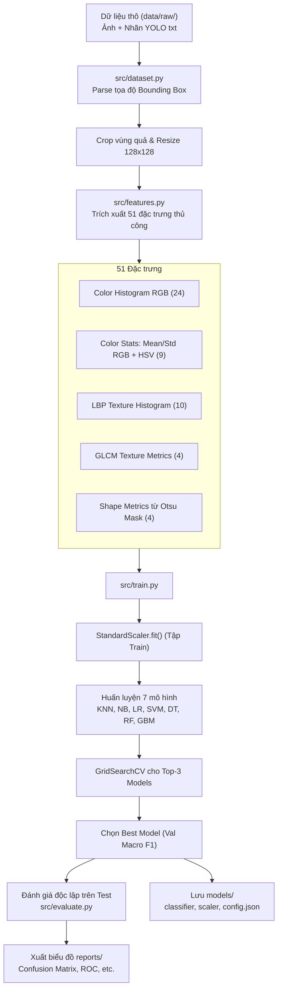

# Kiến trúc hệ thống (Architecture)

## 1. Cấu trúc thư mục dự án

```text
fruit-classification/
├── .agents/skills/                   # Các skill hướng dẫn agent (frontend-design, fruit-ml-project, context-manager)
├── .venv/                            # Virtual environment Python 3.14.7
├── app/
│   └── streamlit_app.py              # Ứng dụng Web UI & Dashboard bằng Streamlit
├── context/                          # Lưu trữ context dự án (Context Manager)
│   ├── README.md
│   ├── project-overview.md
│   ├── architecture.md
│   ├── decisions.md
│   ├── progress.md
│   ├── issues.md
│   ├── changelog.md
│   └── sessions/
│       └── 2026-10-30.md
├── data/
│   ├── README.md                     # Mô tả dữ liệu
│   ├── raw/                          # Dữ liệu gốc định dạng YOLO (images & labels: train, val, test)
│   │   ├── images/
│   │   ├── labels/
│   │   └── data.yaml                 # Cấu hình 9 lớp
│   └── processed/                    # Dữ liệu sau lọc / xuất
├── docs/
│   └── AGENT_PROJECT_SPEC.md         # Đặc tả chi tiết dự án từ báo cáo Word
├── models/                           # Thư mục lưu trữ artifact mô hình
│   ├── classifier.joblib             # Mô hình tốt nhất (SVM / RF / GBM)
│   ├── scaler.joblib                 # StandardScaler đã fit trên tập train
│   ├── pca.joblib                    # PCA model (nếu kích hoạt)
│   └── config.json                   # Metadata mô hình, cấu hình và metrics
├── reports/                          # Báo cáo và biểu đồ trực quan hóa
│   ├── confusion_matrix.png
│   ├── roc_curves.png
│   ├── model_comparison.png
│   ├── feature_importance.png
│   └── classification_report_*.txt
├── src/                              # Mã nguồn nghiệp vụ
│   ├── __init__.py
│   ├── data.py                       # Tiện ích đọc & kiểm tra tính hợp lệ của ảnh
│   ├── dataset.py                    # Parser YOLO & Bounding box cropper
│   ├── features.py                   # Trích xuất 51 đặc trưng (Color, Texture, Shape)
│   ├── train.py                      # Pipeline huấn luyện 7 mô hình + GridSearch + Export
│   ├── evaluate.py                   # Đánh giá metrics & xuất biểu đồ
│   ├── predict.py                    # Inference engine FruitClassifier
│   └── filter_dataset.py             # Script lọc và đồng bộ dataset YOLO
├── tests/
│   ├── test_data.py                  # Unit test cho src/data.py
│   └── test_pipeline.py              # Unit test cho dataset, feature extraction, predict
├── AGENTS.md                         # Hướng dẫn quy tắc làm việc cho AI Agent
├── README.md                         # Hướng dẫn cài đặt & sử dụng
└── requirements.txt                  # Danh mục dependencies chuẩn cho Python 3.14
```

## 2. Luồng xử lý dữ liệu (Data Pipeline)



## 3. Luồng dự đoán thời gian thực (Inference Flow)

```mermaid
flowchart LR
    UserImage["Ảnh người dùng upload"] --> Streamlit["Streamlit UI (app/streamlit_app.py)"]
    Streamlit --> PredictEngine["src/predict.py<br/>FruitClassifier.predict()"]
    
    subgraph InferencePipeline ["Pipeline Inference"]
        LoadArt["Nạp models/classifier.joblib<br/>& models/scaler.joblib"]
        Resize["Resize về 128x128"]
        Extract["Trích xuất 51 features"]
        Scale["Scaler.transform()"]
        Predict["Classifier.predict_proba()"]
    end
    
    PredictEngine --> LoadArt
    LoadArt --> Resize --> Extract --> Scale --> Predict
    Predict --> ResultJSON["Kết quả JSON<br/>- Tên lớp & Tiếng Việt<br/>- Độ tin cậy (Confidence)<br/>- Xác suất 9 lớp<br/>- Thời gian xử lý (ms)"]
    ResultJSON --> StreamlitView["Hiển thị trực quan<br/>Thẻ kết quả, Biểu đồ xác suất, Lịch sử"]
```



## 4. Chi tiết các đặc trưng thủ công (Feature Engineering)
Tổng cộng: **51 chiều (features)**
- **Màu sắc (33 chiều)**:
  - 8 bins × 3 kênh (R, G, B) = 24 chiều (histogram chuẩn hóa).
  - Mean & Standard Deviation của 3 kênh R, G, B = 6 chiều.
  - Mean Hue, Mean Saturation, Std Saturation trong không gian màu HSV = 3 chiều.
- **Kết cấu (14 chiều)**:
  - Local Binary Patterns (LBP) với `radius=1`, `points=8`: Histogram chuẩn hóa 10 bins = 10 chiều.
  - Gray-Level Co-occurrence Matrix (GLCM): Contrast, Dissimilarity, Homogeneity, Energy = 4 chiều.
- **Hình dạng & Kích thước (4 chiều)**:
  - Phân đoạn tiền cảnh bằng ngưỡng tự động Otsu (`cv2.THRESH_OTSU`), tìm contour quả lớn nhất:
  - `area_ratio`: Diện tích contour / Diện tích ảnh.
  - `aspect_ratio`: Chiều rộng bounding box / Chiều cao bounding box.
  - `extent`: Diện tích contour / Diện tích bounding box.
  - `equivalent_diameter`: Đường kính hình tròn tương đương chuẩn hóa.

