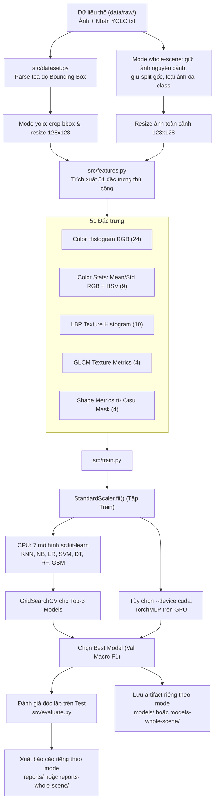

# Kiến trúc hệ thống (Architecture)

## 1. Cấu trúc thư mục dự án

```text
fruit-classification/
├── .agents/skills/                   # Các skill hướng dẫn agent (frontend-design, fruit-ml-project, context-manager)
├── .venv/                            # Virtual environment Python 3.14.7
├── app/
│   ├── streamlit_app.py              # Bản Streamlit cũ để đối chiếu
│   └── web/
│       ├── main.py                   # FastAPI app, nạp model một lần khi startup
│       ├── config.py                 # Đường dẫn model, frontend, reports, SQLite
│       ├── schemas.py                # REST response schemas
│       ├── routes/                   # health, prediction, history, statistics, model-info
│       ├── services/                 # Inference validation và SQLite history
│       ├── openapi.json              # Snapshot sinh từ app.openapi()
│       └── frontend/                 # HTML pages và CSS/JavaScript modules
├── context/                          # Lưu trữ context dự án (Context Manager)
│   ├── README.md
│   ├── project-overview.md
│   ├── architecture.md
│   ├── decisions.md
│   ├── progress.md
│   ├── issues.md
│   ├── changelog.md
│   └── sessions/
│       └── 2026-10-30.md
├── data/
│   ├── README.md                     # Mô tả dữ liệu
│   ├── raw/                          # Dữ liệu gốc định dạng YOLO (images & labels: train, val, test)
│   │   ├── images/
│   │   ├── labels/
│   │   └── data.yaml                 # Cấu hình 9 lớp
│   └── processed/                    # Dữ liệu sau lọc / xuất
├── docs/
│   └── AGENT_PROJECT_SPEC.md         # Đặc tả chi tiết dự án từ báo cáo Word
├── models/                           # Thư mục lưu trữ artifact mô hình
│   ├── classifier.joblib             # Mô hình tốt nhất (SVM / RF / GBM)
│   ├── scaler.joblib                 # StandardScaler đã fit trên tập train
│   ├── pca.joblib                    # PCA model (nếu kích hoạt)
│   └── config.json                   # Metadata mô hình, cấu hình và metrics
├── reports/                          # Báo cáo và biểu đồ trực quan hóa
│   ├── confusion_matrix.png
│   ├── roc_curves.png
│   ├── model_comparison.png
│   ├── feature_importance.png
│   └── classification_report_*.txt
├── src/                              # Mã nguồn nghiệp vụ
│   ├── __init__.py
│   ├── data.py                       # Tiện ích đọc & kiểm tra tính hợp lệ của ảnh
│   ├── dataset.py                    # Parser YOLO, crop bbox và xuất dataset ảnh toàn cảnh
│   ├── features.py                   # Trích xuất 51 đặc trưng (Color, Texture, Shape)
│   ├── train.py                      # Pipeline scikit-learn CPU và backend CUDA tùy chọn
│   ├── torch_model.py                # MLP PyTorch tùy chọn; chỉ import PyTorch khi dùng
│   ├── evaluate.py                   # Đánh giá metrics & xuất biểu đồ
│   ├── predict.py                    # Inference engine FruitClassifier
│   └── filter_dataset.py             # Script lọc và đồng bộ dataset YOLO
├── tests/
│   ├── conftest.py                   # Thư mục tạm trong workspace cho Windows sandbox
│   ├── test_data.py                  # Unit test cho src/data.py
│   ├── test_pipeline.py              # Unit test dataset, feature extraction, predict
│   └── test_web_api.py               # REST API tests, không cần dataset/model
├── AGENTS.md                         # Hướng dẫn quy tắc làm việc cho AI Agent
├── README.md                         # Hướng dẫn cài đặt & sử dụng
└── requirements.txt                  # Danh mục dependencies chuẩn cho Python 3.14
```

## 2. Luồng xử lý dữ liệu (Data Pipeline)



Chế độ `whole-scene` được tạo bằng `python -m src.dataset`; ảnh được sao chép
không crop vào `data/processed/whole-scene/{train,val,test}/{class}/`. Chỉ ảnh
có một class duy nhất được giữ lại; manifest lưu số lượng và lý do loại. Khi
train bằng `--dataset-mode whole-scene`, preprocessing resize 128×128 khớp với
`FruitClassifier`; CLI mặc định lưu artifact ở `models-whole-scene/` để không
ghi đè model crop.

Backend CUDA trong `src/torch_model.py` là tùy chọn và không được import bởi
pipeline mặc định. Nó chỉ đưa bước MLP lên GPU; đọc ảnh, trích xuất đặc trưng,
chuẩn hóa và PCA vẫn chạy trên CPU. Artifact chứa trọng số NumPy và có thể suy
luận CPU khi CUDA không khả dụng; môi trường nạp artifact này vẫn cần PyTorch.
Lệnh `--resume` nạp lại TorchMLP cùng scaler/PCA từ `--model-dir` rồi warm-start
trọng số; pipeline scikit-learn không có chế độ tiếp tục train này.

## 3. Luồng dự đoán thời gian thực (Inference Flow)

```mermaid
flowchart LR
    UserImage["Ảnh người dùng upload"] --> WebUI["HTML/CSS/JS (app/web/frontend)"]
    WebUI --> API["FastAPI POST /api/predict"]
    API --> PredictEngine["src/predict.py<br/>FruitClassifier.predict_from_bytes()"]
    
    subgraph InferencePipeline ["Pipeline Inference"]
        LoadArt["Nạp models/classifier.joblib<br/>& models/scaler.joblib"]
        Resize["Resize về 128x128"]
        Extract["Trích xuất 51 features"]
        Scale["Scaler.transform()"]
        Predict["Classifier.predict_proba()"]
    end
    
    PredictEngine --> LoadArt
    LoadArt --> Resize --> Extract --> Scale --> Predict
    Predict --> ResultJSON["Kết quả JSON<br/>- Tên lớp & Tiếng Việt<br/>- Độ tin cậy (Confidence)<br/>- Xác suất 9 lớp<br/>- Thời gian xử lý (ms)"]
    ResultJSON --> History["SQLite metadata<br/>không lưu ảnh"]
    ResultJSON --> WebView["Hiển thị nhãn, độ chín,<br/>confidence/probabilities nếu có"]
```



## 4. Chi tiết các đặc trưng thủ công (Feature Engineering)
Tổng cộng: **51 chiều (features)**
- **Màu sắc (33 chiều)**:
  - 8 bins × 3 kênh (R, G, B) = 24 chiều (histogram chuẩn hóa).
  - Mean & Standard Deviation của 3 kênh R, G, B = 6 chiều.
  - Mean Hue, Mean Saturation, Std Saturation trong không gian màu HSV = 3 chiều.
- **Kết cấu (14 chiều)**:
  - Local Binary Patterns (LBP) với `radius=1`, `points=8`: Histogram chuẩn hóa 10 bins = 10 chiều.
  - Gray-Level Co-occurrence Matrix (GLCM): Contrast, Dissimilarity, Homogeneity, Energy = 4 chiều.
- **Hình dạng & Kích thước (4 chiều)**:
  - Phân đoạn tiền cảnh bằng ngưỡng tự động Otsu (`cv2.THRESH_OTSU`), tìm contour quả lớn nhất:
  - `area_ratio`: Diện tích contour / Diện tích ảnh.
  - `aspect_ratio`: Chiều rộng bounding box / Chiều cao bounding box.
  - `extent`: Diện tích contour / Diện tích bounding box.
  - `equivalent_diameter`: Đường kính hình tròn tương đương chuẩn hóa.

## 5. Web Application hiện tại (TASK-H01)

`app/web/main.py` tạo FastAPI app và phục vụ `frontend/index.html`, các partial trong `frontend/pages/`, CSS/JS từ `/static/` và reports từ `/reports/`. Router được chia theo health, prediction, model-info, history và statistics. Ứng dụng mặc định cùng origin nên không cần CORS.

Khi startup, app khởi tạo SQLite và nạp một `FruitClassifier` từ `models/`. Nếu model thiếu/lỗi, giao diện vẫn hoạt động và health trả trạng thái `degraded`; endpoint model-info/predict trả 503. Prediction route giới hạn upload ở 10 MB, kiểm tra định dạng và nội dung ảnh, rồi gọi engine hiện có. Response chỉ đưa xác suất khi classifier hỗ trợ `predict_proba`.

SQLite lưu tên file, lớp dự đoán, confidence nếu có, thời gian xử lý và timestamp UTC. Không lưu ảnh hoặc bytes xác suất. `GET /api/statistics` tổng hợp các record thật và trả các lớp không xuất hiện với count bằng 0; metrics train/test vẫn đọc từ config model.

OpenAPI được FastAPI sinh từ route/schema khai báo tại runtime (`/openapi.json`). `app/web/export_openapi.py` xuất snapshot `app/web/openapi.json`; `tests/test_web_api.py` so sánh snapshot với schema runtime để giữ contract đồng bộ.
